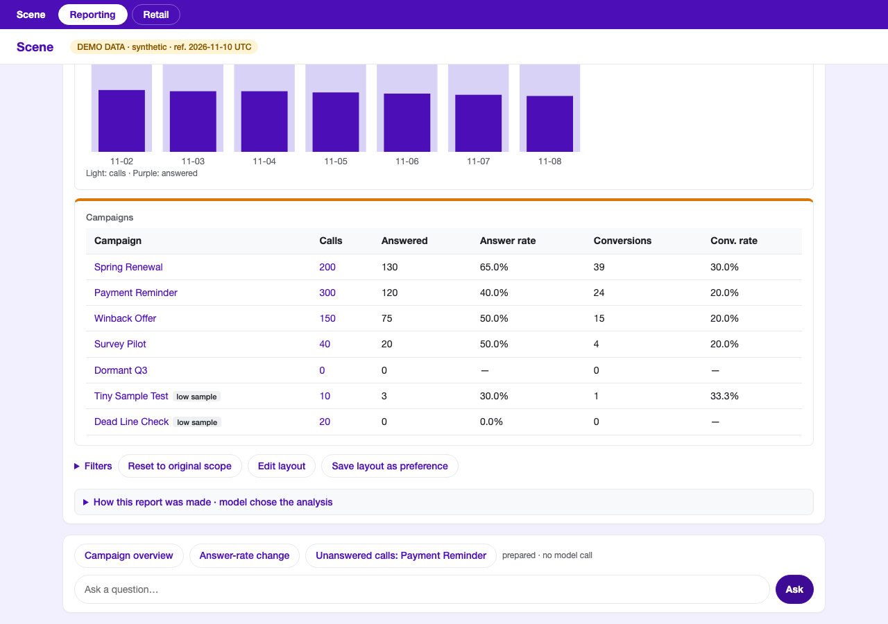
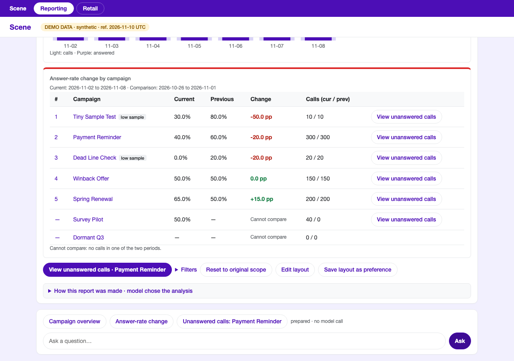
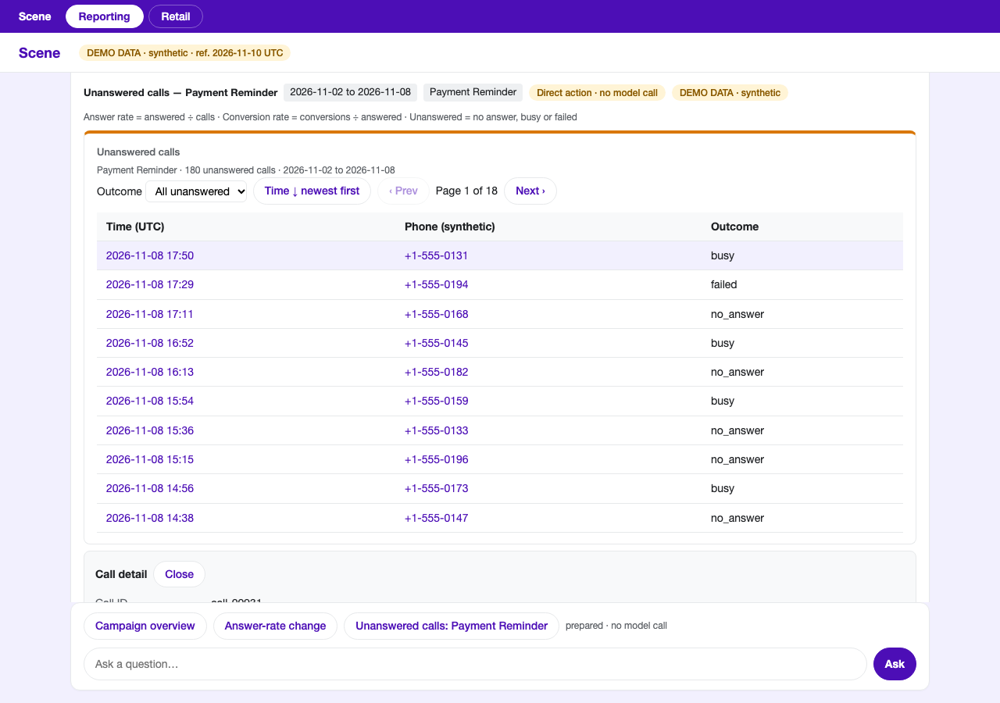
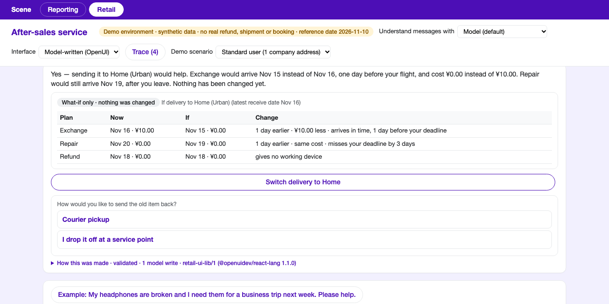
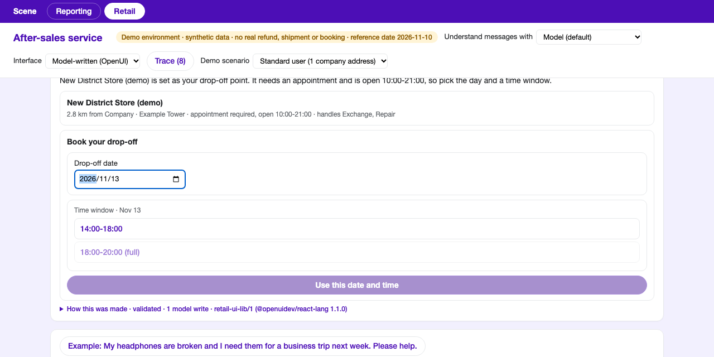
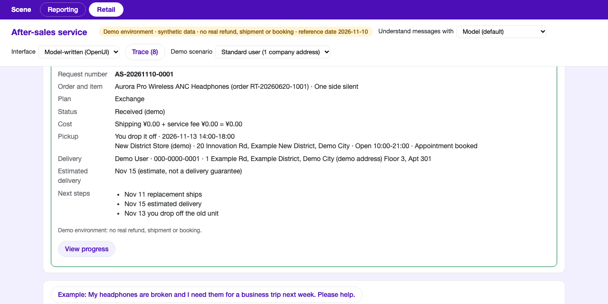

# Scene — conversational campaign reporting and retail after-sales (MVP) · v0.5.0

Scene is an experiment in **agent-driven generative UI**, the idea behind A2UI: an AI agent answers in chat with **interactive UI inside the conversation**, built only from components that the application registers and validates. It is built on OpenUI Lang, not on the A2UI protocol (see [Relationship to A2UI and OpenUI](#relationship-to-a2ui-and-openui)). Two modes sit behind tabs at the top of the app:

- **Reporting**: ask about outbound call campaigns in plain language ("How did each campaign do last week?") and get a report in the reply: summary text, metric cards, a daily chart and a Campaign table. Filter, sort, drill into unanswered calls and edit the report's layout inside the message.
- **Retail**: handle an after-sales request in conversation ("My headphones are broken and I need them for a business trip next week"). The assistant asks one thing per turn, compares exchange, repair and refund, books a drop-off or pickup, shows a summary, and ends with a simulated receipt. You can also ask questions and what-ifs.

All data is **synthetic demo data** with a fixed reference date of 2026-11-10, and the receipt comes from a simulated service: no real refund, shipment or booking. A DeepSeek model understands the question or plans the turn, but **the application computes every number and owns every state change**; the model never supplies a figure. **You can try both modes without any API key** (see below).

Terms: a *Campaign* is an outbound call campaign; *OpenUI* (`@openuidev/react-lang`) renders UI described in a small text language; *OpenPencil* is the design-file tool used to round-trip Reporting layouts.

## What it looks like

All screenshots show synthetic demo data.

### Reporting



*A Reporting reply: daily chart, Campaign table (with `low sample` flags), and the filter, reset and layout actions. The prepared-analysis chips sit above the input.*



*Answer-rate change: current versus previous period for each campaign, and a button that drills into the campaign that dropped the most.*



*Drill-down: a new reply with the unanswered calls of one campaign, with an outcome filter, sorting and paging. Clicking a call opens its detail.*

### Retail



*A what-if: the model writes the answer, and the application fills in the comparison. Nothing changes until you press the button to adopt it.*



*A model-written appointment form. The application offers only time windows inside the store's opening hours and marks full ones.*



*The simulated receipt after Confirm and submit. No real refund, shipment or booking is made.*

The Retail screenshots were taken with the model switched on (see below). Without a key you can still reach the same flow with the fixed cards.

## Quick start

Requirements: Node 22.6 or newer (tested with Node 24) and npm.

```bash
git clone https://github.com/nick-dafeige/a2ui-openui-demo.git && cd a2ui-openui-demo
npm install
npm run dev                        # http://localhost:5173
```

If port 5173 is taken, run `SCENE_PORT=5183 npm run dev` and open that port instead. Open the app in a browser; the tabs at the top switch between **Reporting** and **Retail**.

## Try it without an API key

Without a key the app starts normally. Whatever needs the model shows an error message and changes nothing; it never pretends to have succeeded.

### Reporting

1. Click the **Campaign overview** chip above the input. You get a reply with summary text, three cards, a daily chart and a Campaign table, with the date range, the campaigns and the metric definitions shown on the reply, plus a "DEMO DATA" badge and a "Prepared fallback analysis" badge.
2. Click **Answer-rate change**. A new reply appears: a conclusion (Payment Reminder dropped the most, 60.0% to 40.0%), the current and previous periods, a ranking, a trend and a **View unanswered calls** button.
3. Click that button. The click is logged in the stream, then a new reply shows the call list. Filter, sort and page inside it, and click a call to open its detail.
4. On any reply, **Edit layout** changes that report only. **Apply and save as preference** or **Save layout as preference** affects future reports only.

Earlier replies are never rewritten; every follow-up adds a new one. Typing a question needs the model: without a key you will see "The model response failed (model_error: DEEPSEEK_API_KEY not set)" with Retry and the prepared analyses.

### Retail

1. Open the **Retail** tab and set **Understand messages with** to **Rules only (no model calls)**. (The default, **Model**, needs a key; without one you will see "I could not get the model to read that message" with buttons to retry or to use the basic rules for that message.)
2. Click the example message, "My headphones are broken and I need them for a business trip next week. Please help."
3. The assistant asks one thing per turn. Answer by clicking or by typing a plain sentence: item → what is wrong → latest receive date → plan (exchange, repair or refund) → how the old item goes back (courier, or you drop it off) → service point and appointment time if you drop it off → summary.
4. Press **Confirm and submit** on the summary. The receipt comes from the simulated service. The *Demo scenario* selector covers no company address, several company addresses and a failing first submit.

## Try it with the model (optional, paid)

Model calls use the DeepSeek API and **cost money**, so they need two things, and both are deliberate:

1. **A key.** Copy `.env.example` to `.env` and set `DEEPSEEK_API_KEY=<your key>`. `.env` is git-ignored. (Or point `SCENE_ENV_FILE` at an env file elsewhere.)
2. **A request budget.** Create a local ledger file that says how many paid requests the app may send. Without it every model call is refused with `paid_request_budget_exhausted_or_not_authorised`, even when a key is set.

   ```bash
   mkdir -p evidence
   echo '{"maximum_requests": 50, "recorded_requests": 0, "reservations": []}' > evidence/MODEL_CALL_BUDGET.json
   ```

   Choose the number yourself. Every request is recorded **before** it is sent, failed requests count, and nothing is refunded. When `recorded_requests` reaches `maximum_requests` the app stops calling the model. `evidence/` is git-ignored, so the ledger stays on your machine.

Then restart `npm run dev`. A Reporting question uses 1 model request. In Retail, a typed turn uses 2, a button press 1, and a rejected answer can add 1 repair.

Things to try with the model:

- **Reporting**: "How did each campaign do last week?", "Which campaign's answer rate dropped the most?", "Expand Payment Reminder and show me its unanswered calls", "Top 3 campaigns by answer rate", "Just the conversion rate".
- **Retail**: type plain sentences ("The first one, the left side has no sound", "Exchange, ship it to my company", "I would like to drop-off, give me the address"), ask "Why is exchange better for my trip?", or ask a what-if such as "If it went to my home address, how much sooner? Don't change it yet". Nothing changes until you adopt a suggestion. The **Interface** selector switches between the model-written screens (default) and the fixed cards.

### Environment variables

| Variable | Meaning |
|---|---|
| `DEEPSEEK_API_KEY` | API key, read only on the server. The browser never sees it. |
| `DEEPSEEK_BASE_URL` | Optional. Defaults to `https://api.deepseek.com`. |
| `SCENE_PORT` | Port for the dev server and the browser tests. Default 5173. |
| `SCENE_ENV_FILE` | Optional path of an env file to load instead of `./.env`. |
| `SCENE_MODEL_MODE` | `live` (default), or `stub-fail` / `stub-invalid` to simulate a failing model without any network call. The offline tests use `stub-fail`. |

## How it works, in short

- **Reporting**: one model call turns your question into a small JSON request from a closed vocabulary. The application validates it, computes every figure from the data, writes the summary text and renders predefined components as OpenUI inside that reply.
- **Retail**: one model call plans the turn from application facts, and a second writes the screen as OpenUI Lang using only components and fact references the application offers. The application validates it before anything is shown. Only the application's own Confirm button can submit.
- In both modes the browser never sees the key, every paid request is reserved in the ledger first, and a model failure is shown as a failure, never as a success.

Details, diagrams and the reasoning are in [docs/ARCHITECTURE.md](docs/ARCHITECTURE.md), [docs/SEQUENCE-REPORTING.md](docs/SEQUENCE-REPORTING.md) and [docs/SEQUENCE-RETAIL.md](docs/SEQUENCE-RETAIL.md).

## What this experiment checks

The question behind the demo: can a model compose useful UI for each turn of a conversation while the application stays in control? It tries this in two ways:

- **Reporting**: the model only chooses what to analyse, and the application builds the UI from predefined components.
- **Retail**: the model writes the UI itself, as OpenUI Lang, out of a fixed component library and references to facts the application computed. The application validates the program before anything is shown, and a rejected program gets at most one repair attempt.

What the demo shows so far, from single runs rather than benchmarks: the flow works end to end with a real model, the validator does reject and repair bad programs (2 of the 10 requests in one full Retail run were repairs), and a strict check can fail a whole turn on one stray field. These findings and their limits are written up in [docs/ARCHITECTURE.md](docs/ARCHITECTURE.md).

## Relationship to A2UI and OpenUI

[A2UI](https://github.com/google/A2UI) is an open project from Google for agent-driven interfaces. An agent sends a declarative JSON description of the UI, and the client renders it with its own native components instead of running code from the agent.

This demo explores the same idea, an agent composing UI from a catalog of trusted components, but it uses **OpenUI Lang** ([OpenUI](https://www.openui.com), the `@openuidev/react-lang` package) rather than the A2UI JSON protocol. It is not an implementation of A2UI, and it is not affiliated with the A2UI or OpenUI projects. It is an experiment, not production software: the services are simulated and there is no authentication.

## Verify

| Command | What | Cost |
|---|---|---|
| `npm run verify:offline` | Type check, all unit tests, and the browser tests against a server in failure-injection mode | none |
| `npm run verify:live` | 5 questions through the real model (planner level, raw output saved) | 5 requests |
| `npm run test:e2e:live` | Browser checks with the real model: every spec in `e2e-live/` | about 25 requests or more |

`verify:offline` is the one to run after cloning; it needs no key and no network once dependencies are installed. The browser tests need Chromium: run `npx playwright install chromium` once. If port 5173 is busy, run it as `SCENE_PORT=5183 npm run verify:offline`.

The two live commands need the key and the ledger described above and refuse to run without them. `test:e2e:live` runs every live spec; each spec's header states its request count (about 3 for the Reporting demo, up to 8 and 11 to 14 for the two Retail specs, and `live.spec.ts` also calls the model). To spend less, run one spec, for example `SCENE_PORT=5184 npx playwright test -c playwright.live.config.ts e2e-live/retail-openui.spec.ts`.

## Project layout and docs

`src/data` synthetic data and the hand-written spec · `src/query` metrics and validation · `src/ai` planner and budget ledger · `src/chat` message and report state, narrative text · `src/report` OpenUI library and view model · `src/layout` layout, OpenPencil mapping, pins · `src/retail` the Retail mode (rules, state, flow, model-written UI in `openui/`) · `tests/` unit tests, with `tests/expected.json` holding hand-computed expectations · `e2e/` offline browser tests · `e2e-live/` paid browser tests · `scripts/` live verification scripts.

`docs/ARCHITECTURE.md` — how Reporting and Retail work · `docs/SEQUENCE-REPORTING.md`, `docs/SEQUENCE-RETAIL.md` — sequence diagrams · `docs/DECISIONS.md` — why · `docs/TASKS.md` — acceptance · `AGENTS.md` — rules for agents.

## Limits

Synthetic data, local only. The Reporting layout editor is a form that round-trips through an OpenPencil file; the OpenPencil GUI is not embedded or tested. Retail's map is schematic and its submit service is simulated. Live-model checks are single samples.

## License

[MIT](LICENSE).

## Version history

- **v0.5.0**: Retail's screens can be written by the model itself as OpenUI Lang, validated by the application before they render.
- **v0.4.0**: Retail answers questions and what-ifs; the model plans the turn and the application computes every figure.
- **v0.3.0**: the Reporting / Retail switch and the Retail after-sales flow.
- **v0.2.0**: reporting lives in the chat; each reply carries its own report and later questions never rewrite earlier ones.
