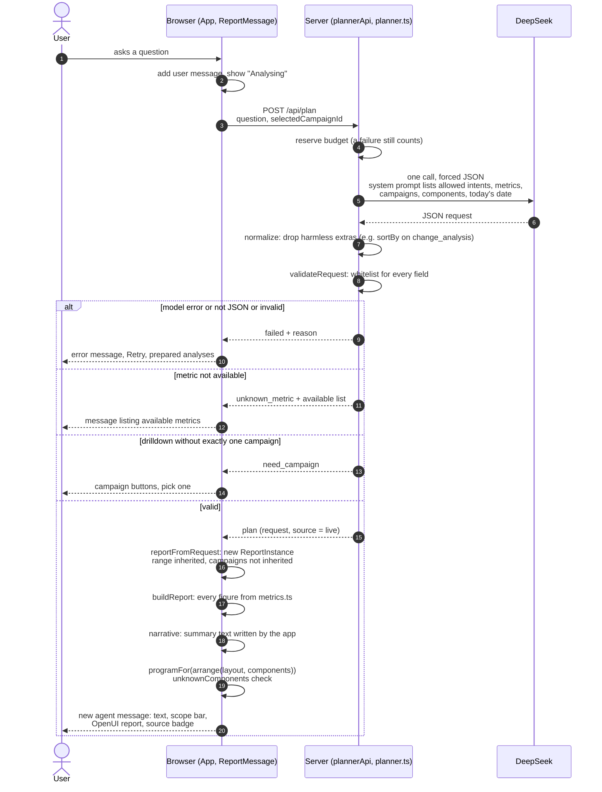
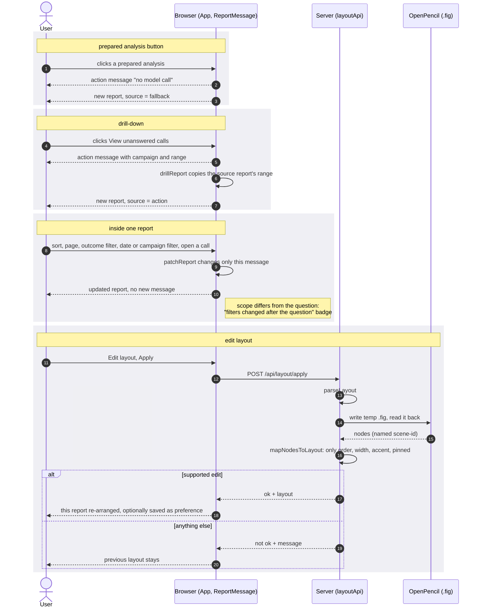

# Reporting sequence diagrams (v0.2.0)

> Based on reading the code on 2026-11-12. The numbers in the worked example were computed locally from the synthetic data (`generateCalls()`); no model was called.
> Related files: `src/App.tsx`, `vite.config.ts` (`plannerApi`, `layoutApi`), `src/ai/planner.ts`, `src/query/validate.ts`, `src/chat/state.ts`, `src/report/model.ts`, `src/report/library.tsx`, `src/chat/narrative.ts`, `src/chat/ReportMessage.tsx`.
> The Retail counterpart is in [SEQUENCE-RETAIL.md](SEQUENCE-RETAIL.md).

## 1. A typed question

One model call per question. The model returns a small JSON request drawn from a closed vocabulary. The figures on screen are computed by the browser from the synthetic data, and the summary text is written by the application.

Key points:

- **Model picks**: step 5 only. `intent`, `metrics`, `campaignIds`, `range`, `components`, `sortBy`, `only`. It may not include numbers, and any extra key is rejected (`unexpected_field`).
- **Application writes**: steps 7 to 15. The OpenUI program is generated from validated component ids, so the model does not write OpenUI in this mode.
- **History is append-only**: each answer is a new message that owns its report. Earlier reports keep their own range, campaign scope and layout.

### Worked example: after the model returns (measured output)

Question "Which Campaign's answer rate dropped the most?"; the model returns `{"intent":"change_analysis","metrics":["answer_rate_change"]}`:

| Step | Result |
|---|---|
| `validateRequest` | `ok`, request passes unchanged |
| `reportFromRequest` | Title "Answer-rate change"; components `answer_rate_card`, `change_ranking`, `daily_trend`; range 2026-11-02 to 11-08; all 7 campaigns |
| `buildReport` | Totals: 720 calls, 348 answered, answer rate 48.3%; comparison period 2026-10-26 to 11-01 |
| Change rows (campaign, current calls, previous calls, change in pp) | c6 10/10 −50; c2 300/300 −20; c7 20/20 −20; c3 150/150 0; c1 200/200 +15; c4 40/0 cannot compare; c5 0/0 cannot compare |
| `narrative` | "Payment Reminder dropped the most: answer rate 60.0% → 40.0% (-20.0 pp), 2026-11-02–2026-11-08 versus 2026-10-26–2026-11-01. Tiny Sample Test fell more (-50.0 pp) but has only 10 / 10 calls (current / previous), below 30, so it is not used as the conclusion." |
| `programFor` | `root = Report([c0, c1, c2])`, `c0 = MetricCard("answer_rate_card")`, `c1 = DailyTrend("daily_trend")`, `c2 = ChangeRanking("change_ranking")` |
| `unknownComponents` | empty, passes |

The component order comes from the layout (`arrange`), which is why `daily_trend` appears before `change_ranking`.

## 2. Actions that need no model

Prepared analyses, drill-down, filters and layout edits never call DeepSeek. Each carries its own label, so none can pass as a live answer.

Key points:

- **Source badges**: `live`, `fallback` (prepared) and `action` (a click). They are never mixed.
- **Local state only**: filters and paging change that report's own state, not the stream. "Reset to original scope" restores the range that was asked.
- **Layout is style**: a layout never carries query conditions. A preference saved to localStorage affects later reports only.

## 3. How it differs from Retail

| | Reporting | Retail |
|---|---|---|
| Model calls per question | 1 | 2 for a typed turn, 1 for a control press |
| Who writes the OpenUI program | The application (`programFor`) | The model, checked by `checkLang` |
| Who writes the summary text | The application (`narrative`) | The model, with figures restricted to the facts |
