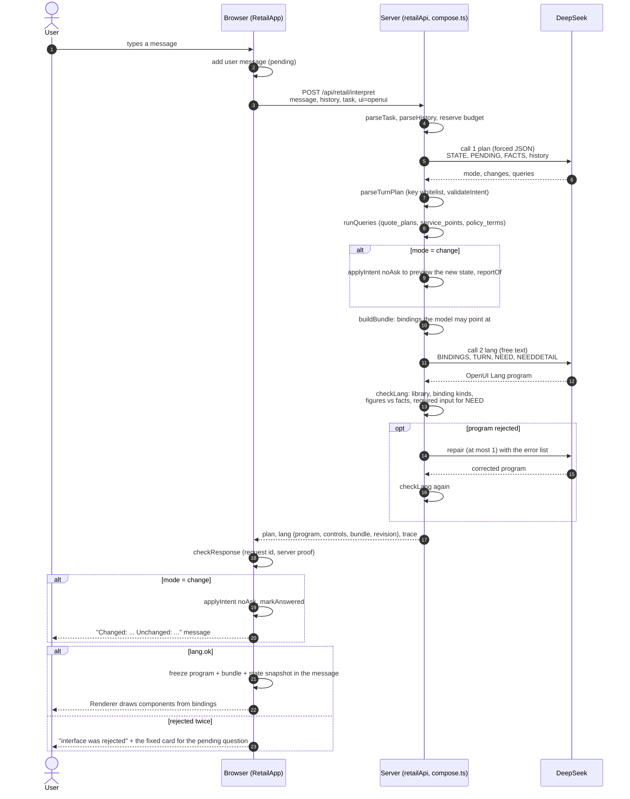
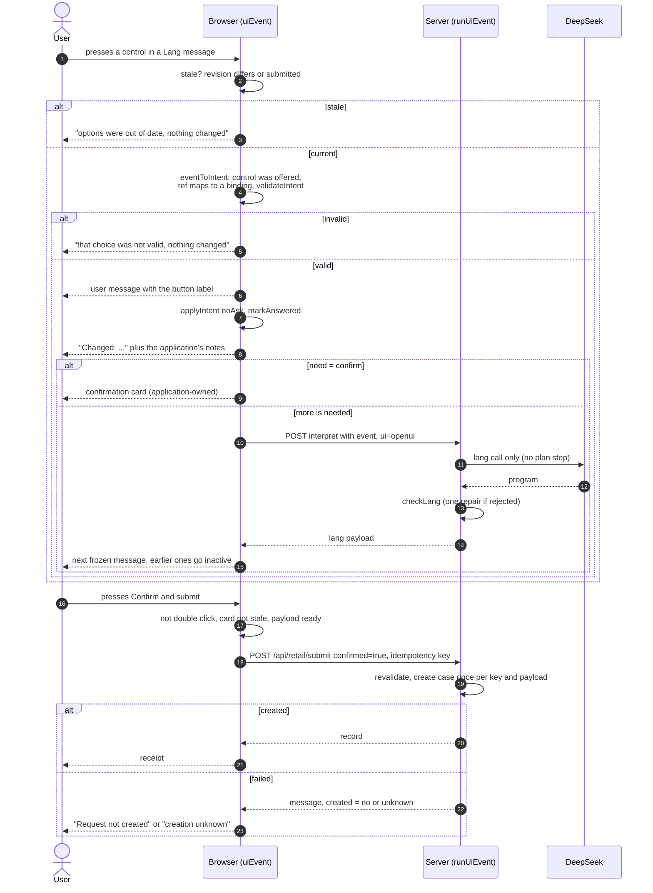

# Retail sequence diagrams (v0.5.0, model-written interface)

> Based on reading the code on 2026-11-12, cross-checked against a real run the same day (6 turns, 10 model requests, 2 repairs; evidence is kept locally under `evidence/`, which is not committed).
> Related files: `src/retail/RetailApp.tsx`, `vite.config.ts` (`retailApi`), `src/retail/openui/compose.ts`, `validate.ts`, `events.ts`, `bundle.ts`, `library.tsx`, `LangMessage.tsx`, `src/retail/turn.ts`, `flow.ts`.
> The Reporting counterpart is in [SEQUENCE-REPORTING.md](SEQUENCE-REPORTING.md).

## 1. A typed message

Two model calls per turn: the first decides what the user meant, the second writes the screen. The server never changes any state. The browser applies the change itself with the same pure function, `applyIntent`.

Key points:

- **Model proposes**: steps 5 and 11. Both outputs are untrusted text and do not reach the user until a check passes.
- **Application decides**: steps 6 to 10 and 13. The whitelists, the read-only tools, the state change and the figure guard are plain code.
- **discuss and what_if turns**: the `alt` branch is skipped and any `changes` from the model are dropped, so these turns cannot alter state.

## 2. A control press, then submit

Buttons, pickers and choices inside the screen emit an event. The event is checked, turned into the same `Intent` that typed text would produce, and only then does the model write what comes next, in one call.

Key points:

- **One path for state**: typed text and pressed controls both end in `applyIntent`, so a control cannot do anything the typed route could not.
- **Only the application submits**: the model can write a button, but submission exists only on the application's own Confirm card, and the server validates it again.
- **Frozen history**: each Lang message keeps its own bundle and state snapshot, and its controls switch off once the task revision moves on.

## 3. Model calls per scenario

| Scenario | Model calls |
|---|---|
| A typed turn | 2 (plan + lang) |
| A control press | 1 (lang) |
| Validation failure | up to 1 more (repair) |
| Rules-only mode | 0 |
